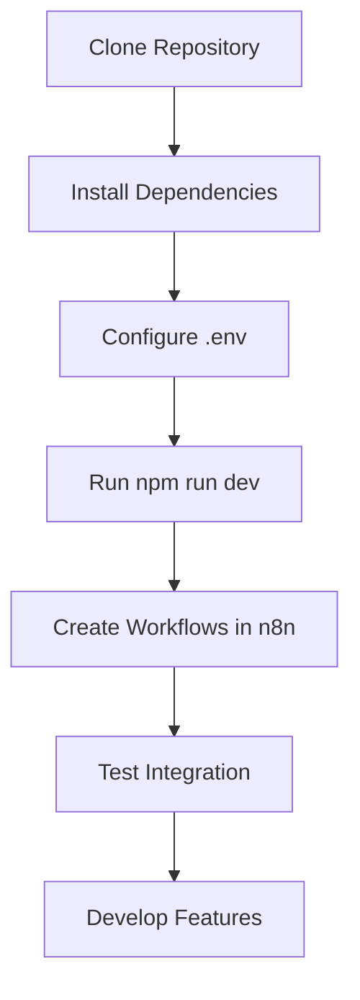

# 📋 Usage Instructions - English

> Complete guide to set up and use Tauri n8n Starter

---

## 🚀 1. Installation and Setup

The project is already configured and ready to use. To get started:

```bash
# Install dependencies (already done)
npm install

# Run in development mode
npm run dev
```

## 🐳 2. n8n Configuration

The `npm run dev` command automatically:
- 🐳 Starts n8n in Docker (port 5678)
- 🖥️ Opens the Tauri application

### 🔑 Default Credentials:

| Service | URL | Username | Password |
|---------|-----|----------|----------|
| **n8n** | http://localhost:5678 | `admin` | `adminadmin` |

## ⚡ 3. Create n8n Workflows

### Workflow 1: Echo Webhook

1. 🌐 Go to http://localhost:5678
2. ➕ Create a new workflow
3. 🔗 Add a "Webhook" node:
   - **Path**: `/echo`
   - **Method**: POST
4. ⚙️ Add a "Function" node:
   ```javascript
   return [{ json: { ok: true, received: $json } }];
   ```
5. 📤 Add a "Respond to Webhook" node:
   - **Body**: `{{$json}}`
6. 💾 Save and activate the workflow

### Workflow 2: Sync Contacts

1. ➕ Create another workflow
2. 🔗 Add a "Webhook" node:
   - **Path**: `/sync-contacts`
   - **Method**: POST
3. ⚙️ Add a "Function" node:
   ```javascript
   const { altas = [], bajas = [], updates = [] } = $json;
   return [{
     json: {
       ok: true,
       counts: { altas: altas.length, bajas: bajas.length, updates: updates.length }
     }
   }];
   ```
4. 📤 Add a "Respond to Webhook" node:
   - **Body**: `{{$json}}`
5. 💾 Save and activate the workflow

## 🧪 4. Test the Integration

1. 🖥️ In the Tauri application, go to the "Workflows" tab
2. 🔘 Click "Test Echo Webhook" - should return the sent JSON
3. 🔘 Click "Sync Contacts (demo)" - should return a summary

## 📊 5. Available Scripts

| Command | Description |
|---------|-------------|
| `npm run dev` | 🚀 Start n8n + Tauri app |
| `npm run dev:n8n` | 🐳 Start only n8n |
| `npm run stop:n8n` | ⏹️ Stop n8n |
| `npm run build` | 📦 Build the application |
| `npm run lint` | 🔍 Run ESLint |
| `npm run format` | ✨ Format with Prettier |

## 📁 6. Project Structure

```
tauri-n8n-starter/
├─ 🎨 src/                          # Frontend React/TypeScript
│  ├─ app/
│  │  ├─ components/                # React Components
│  │  ├─ lib/                      # Utilities and n8n client
│  │  ├─ store/                    # Global state (Zustand)
│  │  └─ routes/                   # Application pages
├─ ⚙️ src-tauri/                    # Backend Tauri (Rust)
│  ├─ src/
│  │  ├─ main.rs                   # Tauri commands
│  │  └─ n8n_proxy.rs              # HTTP client for n8n
├─ 🐳 docker-compose.yml            # n8n configuration
├─ 🔐 .env                         # Environment variables
└─ 📖 README.md                    # Main documentation
```

## 🛡️ 7. Security

- **🔐 Credentials**: Handled in Rust backend
- **🛡️ CSP**: Restrictive configured
- **🔒 Basic Auth**: Enabled in n8n
- **🌍 Variables**: Environment for configuration

## 🎯 8. Recommended Workflow



## 🔧 9. Troubleshooting

### n8n won't start
```bash
# Check Docker
docker --version
docker-compose --version

# Restart n8n
npm run stop:n8n
npm run dev:n8n
```

### Connection error
- Verify port 5678 is free
- Check credentials in `.env`
- Review Docker logs: `docker logs n8n_local`

### Build issues
```bash
# Clean cache
npm run clean
npm install

# Reinstall Rust dependencies
cd src-tauri
cargo clean
cargo build
```

## 📞 10. Support

- 📖 **Documentation**: Check README.md
- 🐛 **Issues**: Report problems on GitHub
- 💬 **Community**: Join Tauri and n8n forums

## 🚀 11. Next Steps

### Customize the Application
1. **Modify UI**: Edit components in `src/app/components/`
2. **Add Features**: Create new Tauri commands in `src-tauri/src/main.rs`
3. **Extend Workflows**: Add more n8n workflows for your use case
4. **Styling**: Customize with TailwindCSS in `src/index.css`

### Production Deployment
1. **Build**: `npm run build`
2. **Test**: Verify all workflows work correctly
3. **Deploy**: Distribute the built application
4. **Monitor**: Set up logging and monitoring

## 📚 12. Additional Resources

- [Tauri Documentation](https://tauri.app/docs/)
- [n8n Documentation](https://docs.n8n.io/)
- [React Documentation](https://reactjs.org/docs/)
- [TypeScript Handbook](https://www.typescriptlang.org/docs/)

---

<div align="center">

**The project is ready to use! 🎉**

[⬆️ Back to main README](../README.md)

</div>
