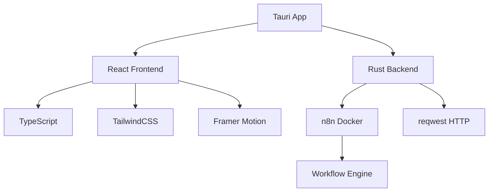
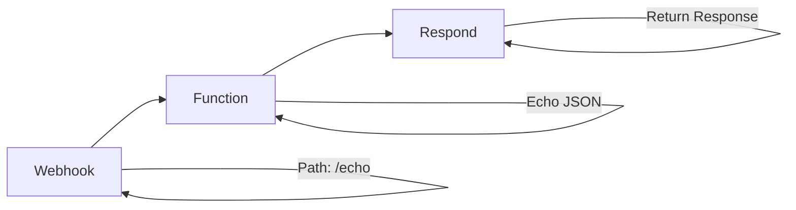
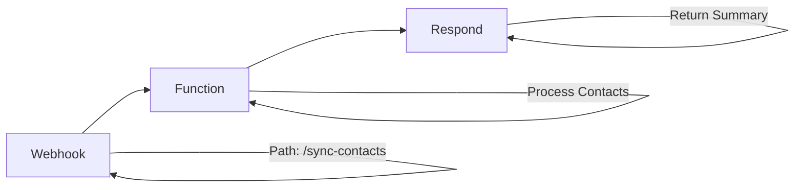

# 🚀 Tauri n8n Starter

> A modern desktop application template that integrates Tauri with n8n for local workflow automation

[](https://tauri.app/)
[](https://reactjs.org/)
[](https://www.typescriptlang.org/)
[](https://n8n.io/)
[](https://www.docker.com/)

<div align="center">
  
  
</div>

---

## ✨ Features

<div align="center">

| 🎨 **Frontend**    | 🖥️ **Desktop**    | ⚡ **Automation** | 🔒 **Security**  |
| ------------------ | ----------------- | ----------------- | ---------------- |
| React + TypeScript | Tauri (Rust)      | n8n + Docker      | Basic Auth       |
| Vite + TailwindCSS | Minimal footprint | Local workflows   | CSP Headers      |
| Framer Motion      | Cross-platform    | Webhook triggers  | Environment vars |

</div>

## 🎯 What You Get

- **🚀 Modern UI**: Beautiful dark theme with smooth animations
- **⚡ Real-time Status**: Live n8n connection monitoring
- **🔧 Ready-to-use**: Pre-configured workflows and examples
- **🛡️ Secure**: Built-in security best practices
- **📱 Cross-platform**: Works on Windows, macOS, and Linux

## 🛠️ Tech Stack



## 📋 Prerequisites

- **Node.js** 18+
- **Rust** toolchain
- **Docker** + Docker Compose

## 🚀 Quick Start

### 1. Clone & Install

```bash
# Clone the repository
git clone <your-repo-url>
cd tauri-n8n-starter

# Install dependencies
npm install
```

### 2. Environment Setup

```bash
# Copy environment variables
cp .env.example .env
```

### 3. Run Development

```bash
# Start n8n + Tauri app
npm run dev
```

This command will:

1. 🐳 Start n8n in Docker (http://localhost:5678)
2. 🖥️ Launch the Tauri desktop application

### 🔑 Default Credentials

| Service | URL                   | Username | Password     |
| ------- | --------------------- | -------- | ------------ |
| **n8n** | http://localhost:5678 | `admin`  | `adminadmin` |

## 📊 Available Scripts

| Command            | Description              |
| ------------------ | ------------------------ |
| `npm run dev`      | 🚀 Start n8n + Tauri app |
| `npm run dev:n8n`  | 🐳 Start only n8n        |
| `npm run stop:n8n` | ⏹️ Stop n8n              |
| `npm run build`    | 📦 Build production app  |
| `npm run lint`     | 🔍 Run ESLint            |
| `npm run format`   | ✨ Format with Prettier  |

## 🔧 n8n Workflows

### 1. Webhook Echo

Create a workflow in n8n with:



**Configuration:**

- **Start Node**: Webhook
  - Path: `/echo`
  - Method: POST
- **Function Node**:
  ```javascript
  return [{ json: { ok: true, received: $json } }];
  ```
- **Respond Node**: Body: `{{$json}}`

### 2. Sync Contacts

Create a workflow in n8n with:



**Configuration:**

- **Start Node**: Webhook
  - Path: `/sync-contacts`
  - Method: POST
- **Function Node**:
  ```javascript
  const { altas = [], bajas = [], updates = [] } = $json;
  return [
    {
      json: {
        ok: true,
        counts: { altas: altas.length, bajas: bajas.length, updates: updates.length },
      },
    },
  ];
  ```
- **Respond Node**: Body: `{{$json}}`

## 📁 Project Structure

```
tauri-n8n-starter/
├─ 🎨 src/                          # Frontend React/TypeScript
│  ├─ app/
│  │  ├─ components/                # React Components
│  │  │  ├─ AppShell.tsx           # Main layout
│  │  │  ├─ N8nStatusBadge.tsx     # Status indicator
│  │  │  └─ SyncPanel.tsx          # Workflow testing
│  │  ├─ lib/                      # Utilities
│  │  │  ├─ n8nClient.ts           # n8n API client
│  │  │  └─ ui.ts                  # UI helpers
│  │  ├─ store/                    # State management
│  │  │  └─ appStore.ts            # Zustand store
│  │  └─ routes/                   # Application pages
│  │     ├─ Home.tsx               # Dashboard
│  │     ├─ Workflows.tsx          # Workflow management
│  │     └─ Settings.tsx           # Configuration
│  ├─ App.tsx                      # Main app component
│  ├─ main.tsx                     # Entry point
│  └─ index.css                    # Global styles
├─ ⚙️ src-tauri/                    # Backend Tauri (Rust)
│  ├─ src/
│  │  ├─ main.rs                   # Tauri commands
│  │  └─ n8n_proxy.rs              # HTTP client for n8n
│  ├─ tauri.conf.json              # Tauri configuration
│  └─ Cargo.toml                   # Rust dependencies
├─ 🐳 docker-compose.yml            # n8n configuration
├─ 🔐 .env                         # Environment variables
└─ 📖 README.md                    # This file
```

## 🛡️ Security Features

- **🔐 Credential Management**: Handled securely in Rust backend
- **🛡️ CSP Headers**: Restrictive Content Security Policy
- **🔒 Basic Auth**: n8n authentication enabled
- **🌍 Environment Variables**: Secure configuration management
- **📋 Allowlist**: Minimal Tauri permissions

## 🎨 UI Preview

<div align="center">

### 🏠 Home Dashboard


### ⚡ Workflows Panel


### ⚙️ Settings Page


</div>

## 📖 Documentation

- **[📋 Usage Instructions (English)](INSTRUCTIONS.md)** - Complete setup and usage guide
- **[📋 Instrucciones de Uso (Español)](INSTRUCCIONES.md)** - Guía completa de configuración y uso

## 🤝 Contributing

1. Fork the repository
2. Create your feature branch (`git checkout -b feature/amazing-feature`)
3. Commit your changes (`git commit -m 'Add amazing feature'`)
4. Push to the branch (`git push origin feature/amazing-feature`)
5. Open a Pull Request

## 📄 License

This project is licensed under the MIT License - see the [LICENSE](LICENSE) file for details.

## 🙏 Acknowledgments

- [Tauri](https://tauri.app/) - For the amazing desktop framework
- [n8n](https://n8n.io/) - For the powerful workflow automation
- [React](https://reactjs.org/) - For the frontend framework
- [TailwindCSS](https://tailwindcss.com/) - For the utility-first CSS

---

<div align="center">

**Made with ❤️ for the automation community**

[](https://github.com/yourusername/tauri-n8n-starter)
[](https://github.com/yourusername/tauri-n8n-starter)

</div>
