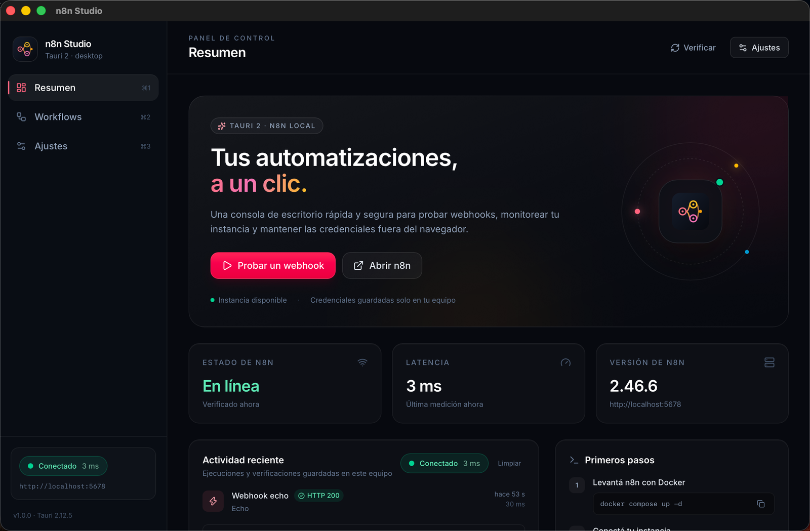
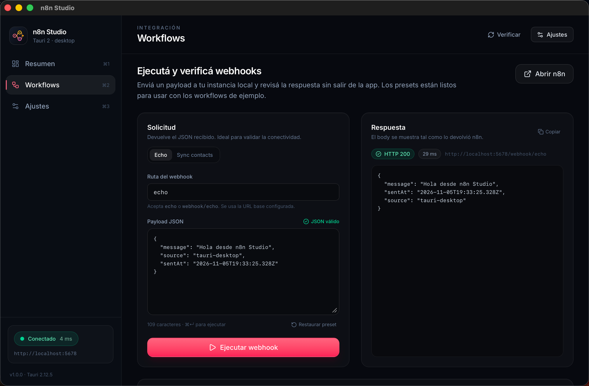
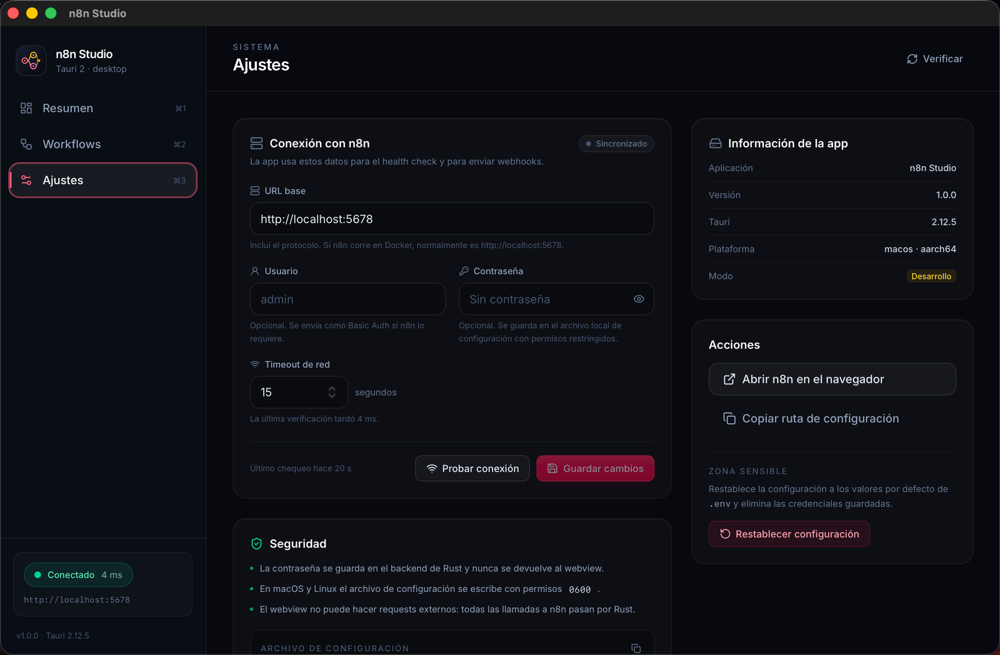
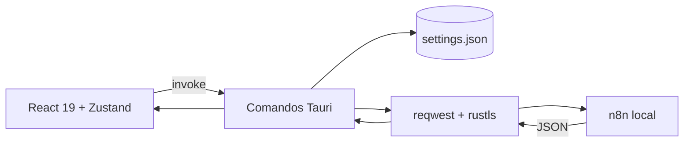

# n8n Studio

<div align="center">
  

  <p><strong>Panel de escritorio para tus automatizaciones locales de n8n.</strong></p>

  <p>
    <a href="https://tauri.app/"></a>
    <a href="https://react.dev/"></a>
    <a href="https://www.typescriptlang.org/"></a>
    <a href="https://tailwindcss.com/"></a>
    <a href="https://www.rust-lang.org/"></a>
    <a href="./LICENSE"></a>
  </p>
</div>



**n8n Studio** es una plantilla de escritorio lista para usar como base de tus propias herramientas de automatización. Combina la velocidad de Tauri 2 con una interfaz moderna en React y un backend en Rust que mantiene las credenciales fuera del webview.

## ✨ Qué incluye

- **Tauri 2 real**: configuración v2, `capabilities`, `build.rs`, íconos y plugin de apertura de enlaces.
- **Backend async en Rust**: `reqwest` + `rustls`, timeouts configurables y errores tipados que llegan a la UI como mensajes claros.
- **Health check en vivo**: estado, latencia y versión de n8n con reintento automático cada 30 segundos.
- **Runner de webhooks**: presets de `echo` y `sync-contacts`, editor de JSON con validación, status HTTP, duración y respuesta completa.
- **Configuración persistente**: URL, usuario, contraseña y timeout guardados en el directorio de la app. La contraseña nunca vuelve al frontend.
- **Historial local**: última actividad de webhooks y verificaciones, persistida en `localStorage`.
- **UI pulida**: tema oscuro, navegación por teclado (`⌘/Ctrl + 1/2/3`), toasts, estados vacíos, skeletons y diseño responsive.
- **Workflows de ejemplo**: importación automática con `npm run n8n:import`.
- **Calidad**: TypeScript estricto, ESLint 10, Prettier, Vitest y tests de Rust.
- **CI incluido**: GitHub Actions para frontend, lint, tests y `cargo clippy`.

## 📸 Capturas

<p align="center">
  
  
</p>

## 🧱 Stack

| Capa           | Tecnología                                       |
| -------------- | ------------------------------------------------ |
| Escritorio     | Tauri 2, Rust 2021, `tauri-plugin-opener`        |
| Frontend       | React 19, TypeScript 5.9, Vite 8, Tailwind CSS 4 |
| Estado         | Zustand 5                                        |
| Animaciones    | Framer Motion 14                                 |
| HTTP           | `reqwest` (rustls) + `tokio::sync::RwLock`       |
| Tipografía     | Inter Variable                                   |
| Tests          | Vitest + tests nativos de Rust                   |
| Automatización | n8n en Docker Compose                            |

## 📋 Requisitos

- **Node.js 22.12+** (hay un `.nvmrc` con la versión recomendada).
- **Rust estable 1.90+** ([rustup.rs](https://rustup.rs/)).
- **Docker + Docker Compose** para levantar n8n.
- **macOS**: Xcode Command Line Tools.
- **Linux**: dependencias de Tauri (WebKitGTK 4.1, `librsvg`, `patchelf`).

## 🚀 Inicio rápido

```bash
# 1. Instalar dependencias
npm ci

# 2. (Opcional) Copiar los valores por defecto
cp .env.example .env

# 3. Levantar n8n e importar los workflows de ejemplo
npm run n8n:import

# 4. Abrir la app de escritorio
npm run dev:app
```

La primera vez que se abre n8n en <http://localhost:5678> te va a pedir crear la cuenta de propietario. Los workflows de ejemplo se importan y activan automáticamente con el script.

> Si preferís arrancar n8n y la app en un solo paso: `npm run dev:full`. Para importar los workflows después, ejecutá `npm run n8n:import`.

### Scripts disponibles

| Comando              | Qué hace                                                        |
| -------------------- | --------------------------------------------------------------- |
| `npm run dev`        | Solo el frontend en el navegador (sin IPC de Tauri).            |
| `npm run dev:app`    | Abre la app de escritorio con Tauri.                            |
| `npm run dev:n8n`    | Levanta n8n con Docker Compose.                                 |
| `npm run dev:full`   | Levanta n8n y después abre la app.                              |
| `npm run n8n:import` | Levanta n8n, importa y activa los workflows de `n8n/workflows`. |
| `npm run stop:n8n`   | Detiene el contenedor de n8n.                                   |
| `npm run build`      | Typecheck + build del frontend.                                 |
| `npm run build:app`  | Genera el bundle de escritorio (`tauri build`).                 |
| `npm run check`      | Typecheck, ESLint, Vitest y Prettier.                           |
| `npm run test`       | Ejecuta los tests del frontend.                                 |
| `npm run lint`       | ESLint con cero warnings.                                       |
| `npm run format`     | Formatea todo con Prettier.                                     |
| `npm run typecheck`  | Verifica TypeScript (app y configs).                            |

### Tests de Rust

```bash
cargo test --manifest-path src-tauri/Cargo.toml
cargo clippy --manifest-path src-tauri/Cargo.toml --all-targets -- -D warnings
```

## 🔌 Workflows de ejemplo

| Workflow      | Endpoint                      | Respuesta                                    |
| ------------- | ----------------------------- | -------------------------------------------- |
| Echo          | `POST /webhook/echo`          | El mismo JSON recibido.                      |
| Sync contacts | `POST /webhook/sync-contacts` | `{ ok, counts: { altas, bajas, updates } }`. |

La app envía el payload a `{baseUrl}/webhook/{ruta}`. Podés escribir `echo` o la ruta completa `webhook/echo`; también se acepta `webhook-test/echo` para probar con el webhook en modo escucha de n8n.

### Importación manual

1. En n8n, abrí **Workflows → Import from File**.
2. Elegí `n8n/workflows/echo.json` y `n8n/workflows/sync-contacts.json`.
3. Activá cada workflow con el toggle **Active**.

El script `npm run n8n:import` hace exactamente eso por CLI y activa los workflows de ejemplo.

## ⚙️ Configuración y seguridad

La URL, el usuario, la contraseña y el timeout se administran desde **Ajustes** y se guardan en:

- **macOS**: `~/Library/Application Support/com.marcosbentivegna.n8nstudio/settings.json`
- **Windows**: `%APPDATA%\com.marcosbentivegna.n8nstudio\settings.json`
- **Linux**: `~/.config/com.marcosbentivegna.n8nstudio/settings.json`

La ruta exacta también se muestra y se puede copiar desde la pantalla de Ajustes.

- La **contraseña nunca se devuelve** al webview: `get_settings` solo informa `hasPassword`.
- En macOS y Linux el archivo se escribe con permisos `0600` y de forma atómica.
- Las llamadas HTTP se hacen desde Rust; el CSP del webview solo permite IPC local.
- La app soporta **Basic Auth opcional** para instancias antiguas. n8n 1.x+ usa cuentas de usuario y los webhooks no requieren credenciales por defecto.
- `.env` solo se usa como valor inicial o al restablecer la configuración:

```dotenv
N8N_BASE_URL=http://localhost:5678
N8N_USER=
N8N_PASSWORD=
N8N_TIMEOUT_SECS=15
```

## 🏗️ Arquitectura



### Comandos expuestos

| Comando          | Descripción                                                         |
| ---------------- | ------------------------------------------------------------------- |
| `get_settings`   | Devuelve la configuración sin la contraseña.                        |
| `save_settings`  | Valida, normaliza y persiste la configuración.                      |
| `reset_settings` | Vuelve a los valores de `.env` / por defecto.                       |
| `health_check`   | Consulta `/healthz`, mide latencia e intenta leer la versión.       |
| `run_webhook`    | Envía un payload a `/webhook/*` y devuelve status, duración y body. |
| `open_url`       | Abre un enlace http(s) con el navegador del sistema.                |
| `app_info`       | Versión de la app, Tauri, OS, arquitectura y modo.                  |

## 📁 Estructura

```text
.
├── src/
│   ├── app/
│   │   ├── components/
│   │   │   ├── ui/                  # Button, Card, EmptyState
│   │   │   ├── ActivityFeed.tsx
│   │   │   ├── AppShell.tsx
│   │   │   ├── ErrorBoundary.tsx
│   │   │   ├── StatusBadge.tsx
│   │   │   └── ToastViewport.tsx
│   │   ├── lib/                     # Cliente IPC, formato, validación, hooks
│   │   ├── routes/                  # Home, Workflows, Settings
│   │   ├── store/appStore.ts        # Estado global con Zustand
│   │   └── types.ts
│   ├── App.tsx
│   ├── index.css                    # Tailwind 4 + tokens de diseño
│   └── main.tsx
├── src-tauri/
│   ├── capabilities/default.json    # Permisos de la ventana principal
│   ├── icons/
│   ├── src/
│   │   ├── commands.rs              # Comandos Tauri
│   │   ├── config.rs                # Settings + persistencia
│   │   ├── error.rs                 # Errores serializables
│   │   ├── lib.rs
│   │   ├── main.rs
│   │   ├── n8n.rs                   # Cliente HTTP y health check
│   │   └── state.rs
│   ├── build.rs
│   ├── Cargo.toml
│   ├── tauri.conf.json
│   └── tauri.dev.conf.json          # CSP relajado solo para desarrollo
├── n8n/workflows/                   # Workflows de ejemplo importables
├── scripts/import-workflows.sh
├── docker-compose.yml
└── .github/workflows/ci.yml
```

## 🛠️ Desarrollo

```bash
# Frontend con HMR, sin Tauri (modo navegador)
npm run dev

# App de escritorio completa
npm run dev:app

# Calidad antes de commitear
npm run check
```

El modo navegador es útil para iterar en la UI: muestra un aviso y deshabilita las funciones que dependen del IPC de Tauri. Para probar la integración real usá `npm run dev:app`.

La CSP de desarrollo se define en `src-tauri/tauri.dev.conf.json` para permitir el HMR de Vite. La build de producción usa la CSP estricta de `tauri.conf.json`.

### Cambiar el nombre o el identificador

Antes de publicar tu propia app, editá:

- `productName` e `identifier` en `src-tauri/tauri.conf.json`.
- `name` y `version` en `package.json` y `src-tauri/Cargo.toml`.
- El ícono: reemplazá `app-icon.svg` y ejecutá `npx tauri icon app-icon.svg`.

> El identificador `com.marcosbentivegna.n8nstudio` es único para esta plantilla. Cambialo por uno propio para evitar conflictos de datos y de bundle.

## 📦 Build y distribución

```bash
npm run build:app
```

Los artefactos quedan en `src-tauri/target/release/bundle/` (`.app`/`.dmg` en macOS, `.msi`/`.exe` en Windows, `.deb`/`.AppImage` en Linux).

- Para distribuir en macOS necesitás **codesign** y **notarización** con una cuenta de Apple Developer.
- En Windows, firmá el instalador para evitar advertencias de SmartScreen.
- El updater no está incluido por defecto; podés agregar `tauri-plugin-updater` cuando tengas un canal de releases.

## 🩺 Troubleshooting

### La app dice “Sin conexión”

```bash
curl http://localhost:5678/healthz
docker compose ps
docker compose logs -f n8n
```

Verificá que el puerto `5678` esté libre y que la URL de Ajustes sea exactamente la de n8n.

### El webhook devuelve 404

- El workflow tiene que estar **activo**.
- La ruta del webhook debe coincidir (`echo`, `sync-contacts`).
- En modo escucha de n8n usá `webhook-test/...`; en producción usá `webhook/...`.

### El puerto 1420 está ocupado

Cerrá el proceso que lo esté usando:

```bash
lsof -ti tcp:1420 | xargs kill
```

### Quiero empezar de cero

- En la app: **Ajustes → Restablecer configuración**.
- n8n: `npm run stop:n8n && docker compose down -v` (borra también los datos y workflows).

### Error al compilar en Linux

Instalá las dependencias de Tauri:

```bash
sudo apt update
sudo apt install libwebkit2gtk-4.1-dev build-essential curl wget file \
  libxdo-dev libssl-dev libayatana-appindicator3-dev librsvg2-dev patchelf
```

## 🧩 Cómo extenderla

- Agregá comandos en `src-tauri/src/commands.rs` y registralos en `lib.rs`.
- Sumá presets de webhooks en `src/app/routes/Workflows.tsx`.
- Reemplazá los workflows de ejemplo por los tuyos en `n8n/workflows/`.
- Para integraciones con la API pública de n8n, agregá el header `X-N8N-API-KEY` en el cliente Rust y un campo nuevo en Settings.

## 📄 Licencia

MIT © 2026 Marcos Bentivegna. Ver [LICENSE](./LICENSE).

---

Hecho con Tauri, Rust, React y n8n.
